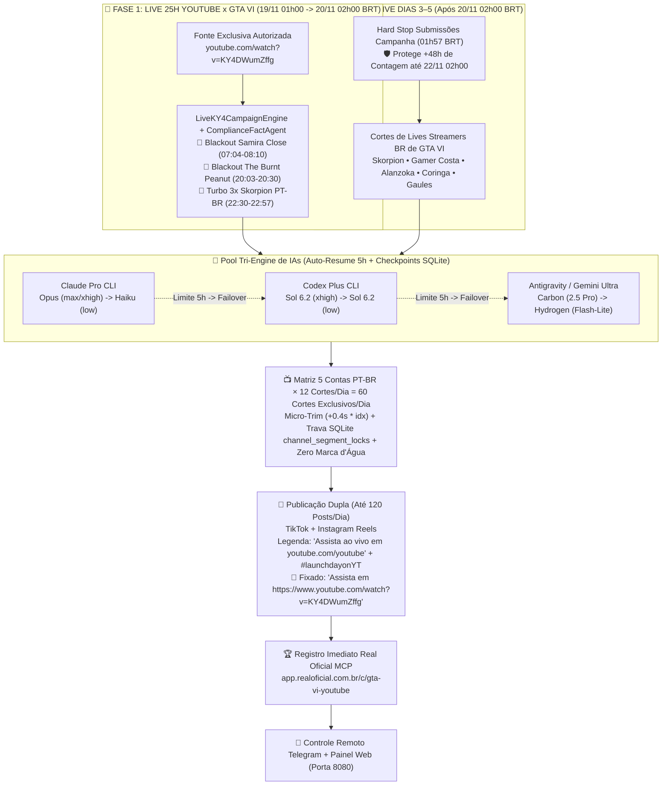

# 🔥 GTA VI Live Clippers BR & Real Oficial (`gta-vi-youtube`) — Operação Autônoma 5 Canais × Pool Tri-IA (24/7)

Sistema multi-agente em Python projetado para rodar **100% no piloto automático em um 2º PC durante 5 dias seguidos** (1 dia configurando/validando + 4 dias fora gerenciando tudo pelo celular via Telegram), construído sob medida para dominar o **Campeonato Real Oficial: Live YouTube × GTA VI** e escalar **5 páginas brasileiras de Cortes de Lives de Streamers**.

---

## 🎯 Resumo Executivo da Operação

- **5 Contas PT-BR Dedicadas de Cortes de Lives**: `12 cortes/dia` por conta = **`60 cortes exclusivos/dia` por rede** -> publicando simultaneamente em **TikTok + Instagram Reels** = **até `120 publicações/dia`** na campanha!
- **Fase 1 — Plano de Guerra da Live Oficial de 25h (`19/11 01h00 BRT` -> `20/11 02h00 BRT`)**:
  - **Única fonte autorizada (100% exclusiva)**: `https://www.youtube.com/watch?v=KY4DWumZffg` (*Live Oficial YouTube × GTA VI*). Qualquer clipe externo é bloqueado automaticamente.
  - **Plataformas válidas que pagam**: **TikTok** e **Instagram Reels** (**R$ 4,00 a cada 1.000 views** acima de **5.000 views/vídeo**, teto de **R$ 400,00/vídeo**, premiação total de **R$ 25.500,00** + **1 Key oficial de GTA VI** para cada integrante do **TOP 10**). *(YouTube Shorts, Kwai e X ficam desativados no modo campanha pois não pontuam).*
  - **Zero Logos & Zero Marcas d'Água**: renderização limpa `1080x1920` (`9:16`) com `burn_credit_watermark: false` — sem logo de canal, sem marca de terceiros e sem letras de música na tela.
  - **Copy & Comentário Obrigatórios no Checklist**:
    - Legenda contém obrigatoriamente `"Assista ao vivo em youtube.com/youtube"` e **APENAS** a hashtag `#launchdayonYT` (**zero hashtags extras** — `#GTA6`, `#Shorts`, etc. são bloqueadas na campanha!).
    - **1º Comentário Fixado Obrigatório**: `"Assista em https://www.youtube.com/watch?v=KY4DWumZffg"`.
  - **Escudos Anti-Desclassificação Ativos**:
    - 🚫 **Blackout Samira Close (`07h04–08h10 BRT`)**: janela do podcast *Passaporte pra Vice City* sob bloqueio/gate visual estrito (zero segundos de Samira Close em tela).
    - 🚫 **Hard Blackout The Burnt Peanut (`20h03–20h30 BRT`)**: corte temporal e semântico absoluto (`20h00–20h34 BRT` com margem de segurança).
    - 🚫 **Proibições Estritas**: zero GTA V / San Andreas / comparações (*"antes do GTA 6"*), zero críticas/memes negativos/bugs, zero vídeos gerados por IA.
  - **Modo Turbo nos Picos PT-BR**:
    - 🚀 **Gameplay do Skorpion em Português (`22h30–22h57 BRT`)**: multiplicador `3x` de captura e corte imediato!
    - 🔥 **Horário Nobre (`19h00–00h00 BRT`)**: cadência máxima nas 5 contas (respeitando o blackout `20h03–20h30`).
- **Fase 2 — Virada Automática Pós-Live (`20/11 02h00 BRT` -> Dias 3 a 5 Fora de Casa)**:
  - **Hard Stop às `01h57 BRT` de `20/11`**: trava automática de segurança 3 minutos antes do fim da live para nenhum upload cair fora do ar, protegendo a janela de **+48h de contagem de views (até `22/11 02h00 BRT`)** sem deletar, arquivar ou privar nenhum post da campanha.
  - **Pivot Automático para Streamers BR de GTA VI**: a partir de `20/11 02h00 BRT`, as 5 contas mudam sozinhas para **Cortes de Lives de Streamers PT-BR jogando GTA VI** (`@Skorpion`, `@GamerCosta`, `@alanzoka`, `@loud_coringa`, `@PaulinhooLoko`, `@FunkyBlackCat`, `@Gaules`), mantendo o crescimento orgânico 24/7 enquanto você está fora!
- **Monitor Multi-Lives Simultâneas & Replay Retroativo (`live_hype_monitor.py`)**:
  - Igual aos sistemas profissionais de corte em tempo real (como Real Oficial / OBS Replay): mantém na Fase 1 a live `KY4DWumZffg` e na **Fase 2 até `5` lives brasileiras simultâneas em paralelo** (`max_concurrent_lives: 5` usando FFmpeg `-c copy` com `< 3%` de CPU e `~80 MB` fixos por live no SSD). Analisa todas em paralelo a cada **20s** (picos de voz/risada em dB + ação visual `scdet` + chat da Twitch `"CLIPA"`/`"KKKKK"`), **volta 18s no tempo ANTES da reação**, legenda com Whisper PT-BR e roteia cada clipe automaticamente para o canal temático ideal (`ch1..ch5`) sem colisão!
- **Pool Tri-IA Resiliente (`Claude Pro` + `Codex Plus` + `Antigravity Ultra`)**:
  - Divisão inteligente de esforço (`THINK_XHIGH` vs `EXECUTE_LOW`), detecção automática de limite de **5 horas**, failover instantâneo sem perder progresso via SQLite (`task_checkpoints`) e sondas de retomada a cada 15 minutos.

---

## 🗺️ Arquitetura Operacional — Guerra 25h (`KY4DWumZffg`) + Pós-Live + Pool Tri-IA



---

## 📺 Matriz das 5 Contas PT-BR de Cortes de Lives (`config/channels_matrix.yaml`)

Cada página opera com **12 horários escalonados em +15 min** (evitando colisão de upload e IP no 2º PC), **micro-trim determinístico (`+0.4s * channel_idx`)**, trava atômica no SQLite (`channel_segment_locks`) para **jamais repetir o mesmo trecho no mesmo dia**, layout 9:16 próprio, cor exclusiva de legenda `.ass` e voz neural PT-BR distinta para dublagens/narrações permitidas.

> **Importante**: O pilar de comparações/nostalgia com jogos antigos foi **100% removido** de todos os canais, garantindo conformidade total com a regra anti-GTA V da campanha.

| # | ID (`channel_id`) | Página PT-BR | Handle | Ângulo Editorial | Layout & Cor `.ass` | IA Preferencial (`THINK_XHIGH`) |
|---|---|---|---|---|---|---|
| **1** | `ch1_plantao_oficial` | **Cortes Live Leonida** | `@cortesliveleonida` | Melhores Reações Ao Vivo & Momentos Insanos da Live | `blur_pad_hud` • Ciano | `claude_pro` |
| **2** | `ch2_leonida_segredos` | **Radar Streamers Vice** | `@radarstreamersvice` | Descobertas Ao Vivo, Mapa & Easter Eggs dos Streamers | `smart_crop` • Magenta | `codex_plus` |
| **3** | `ch3_gta6_dicas_pro` | **Plays & Clutches GTA 6** | `@playsgta6live` | Jogadas de Alto Nível, Fugas & Gameplay do Skorpion/Streamers | `blur_pad_hud` • Amarelo | `antigravity_ultra` |
| **4** | `ch4_vice_motores` | **Fugas & Motores Live** | `@fugasmotoreslive` | Perseguições Ao Vivo, Carros & Caos em Vice City | `smart_crop` • Laranja | `claude_pro` |
| **5** | `ch5_vice_stories` | **Cortes Resenha Vice** | `@cortesresenhavice` | Momentos Engraçados Positivos, Hype & Dublagens PT-BR da Live Mundial | `blur_pad_hud` • Verde | `codex_plus` |

---

## 📋 Linha do Tempo & Checklist de Blindagem da Campanha (`KY4DWumZffg`)

Configurado em [`config/campaign_realoficial.yaml`](config/campaign_realoficial.yaml) (Fuso `America/Sao_Paulo` — BRT):

| Horário (BRT) | Evento / Janela | Ação Automática do Sistema |
|---|---|---|
| **Antes de `19/11 01h00`** | `PRE_LIVE` (Aquecimento) | Bloqueia envios prematuros na campanha; valida credenciais, FFmpeg e filas. |
| **`19/11 01h00`** | **Início Oficial da Live (25h)** | Libera captura exclusiva de `https://www.youtube.com/watch?v=KY4DWumZffg` e envios em **TikTok + Instagram Reels**. |
| **`19/11 07h04 – 08h10`** | ⚠️ Podcast *Passaporte pra Vice City* | **Escudo Samira Close ativo** (`07h02–08h12` com margem): exige gate visual estrito / bloqueio preventivo caso você esteja ausente (zero segundos da Samira Close em tela). |
| **`19/11 19h00 – 00h00`** | 🔥 **Horário Nobre BR** | Prioridade máxima de publicação e distribuição nos 5 canais. |
| **`19/11 20h03 – 20h30`** | 🚫 **The Burnt Peanut na Live** | **Hard Blackout absoluto (`20h00–20h34`)**: qualquer segmento ou menção é descartado na hora. |
| **`19/11 22h30 – 22h57`** | 🚀 **Gameplay PT-BR do Skorpion** | **OURO PURO (`burst_multiplier: 3`)**: captura prioritária em rajada para abastecer os 5 canais com gameplay em português! |
| **`20/11 01h57`** | 🛑 **Hard Stop de Uploads da Campanha** | Trava submissões 3 minutos antes das `02h00` para garantir que 100% dos links sejam publicados e registrados **enquanto a live está no ar**. |
| **`20/11 02h00 -> 22/11 02h00`** | 💰 **Contagem +48h & Virada Streamers BR** | Nenhum vídeo da campanha é apagado/arquivado; os 5 canais viram automaticamente para **Cortes de Lives de Streamers BR de GTA VI** pelos dias restantes! |

### As Regras de Ouro Verificadas Automaticamente Antes de Cada Upload
1. **Fonte 100% Exclusiva**: na campanha (`for_real_oficial_campaign=True`), somente `KY4DWumZffg` passa no [`ComplianceFactAgent`](src/gta6_agents/agents/compliance.py).
2. **Zero Marca d'Água / Zero Logo**: `burn_credit_watermark: false` — vídeo `1080x1920` limpo, prendendo nos **2 primeiros segundos** com legendas dinâmicas `.ass` das falas.
3. **Texto Obrigatório na Legenda**: `"Assista ao vivo em youtube.com/youtube"` + **somente** `#launchdayonYT` (qualquer hashtag adicional como `#GTA6` reprova o corte no modo campanha).
4. **1º Comentário Fixado**: `"Assista em https://www.youtube.com/watch?v=KY4DWumZffg"`.
5. **Hype 100% Positivo & Sem Jogos Antigos**: bloqueia termos de comparação com *GTA V*, *San Andreas*, *"antes do GTA 6"*, bugs, críticas negativas, leaks ou IA falsa.
6. **Fora da Campanha (`for_campaign=False` / Pós-Live)**: restaura automaticamente as regras orgânicas de cortes de streamers (crédito `🎥 @creator`, zero hashtags no X, tags nativas no Reels/TikTok).

---

## 🤖 Pool Tri-IA com Auto-Resume de 5 Horas (`tri_engine_pool.py`)

Para sustentar **60 cortes/dia (até 120 posts/dia)** durante 5 dias sem travar quando o `Claude Pro` ou o `Codex Plus` atingirem o limite da janela móvel de 5 horas:

1. **Separação `THINK_XHIGH` vs `EXECUTE_LOW` (faz a cota render até 4× mais)**:
   - **`Claude Pro`**: usa `Opus` (`--effort max` / `xhigh`) apenas para estratégia viral, escolha de timestamps não-sobrepostos e auditoria de regras (`THINK_XHIGH`), e `Haiku` (`low`) para formatação mecânica de legendas `.ass` e JSON (`EXECUTE_LOW`).
   - **`Codex Plus`**: usa `sol-6.2` com `model_reasoning_effort="xhigh"` para pensar e `model_reasoning_effort="low"` para executar.
   - **`Antigravity / Gemini Ultra`**: usa o roteador em camadas **Carbon** (`gemini-2.5-pro`) para raciocínio pesado e **Hydrogen** (`gemini-2.5-flash-lite`) para execução rápida, além de fallback determinístico local (`TEMPLATE_FALLBACK`) caso todas as 3 IAs estejam simultaneamente em janela de espera.
2. **Checkpoints Atômicos em SQLite (`task_checkpoints`)**:
   - Se o `Claude Pro` concluir o `THINK_XHIGH` (estágio salvo como `READY_TO_EXECUTE`) e bater no limite de 5 horas no meio do `EXECUTE_LOW`, o `Codex Plus` (ou `Antigravity Ultra`) assume **exatamente de `READY_TO_EXECUTE`**, **sem gastar tokens refazendo o `THINK_XHIGH`**!
3. **Detecção de 5h & Sonda Automática a cada 15 Minutos**:
   - O `RateLimitDetector` lê mensagens como `"5-hour usage limit"` / `"Resets in 2h 30m"` / `HTTP 429`, registra `COOLDOWN_5H` na tabela `engine_cooldowns` e dispara sondas leves a cada `15 min` (`900s`) para reintegrar a IA ao pool no minuto exato em que a janela liberar.

---

## ⚡ Como Iniciar Tudo no 2º PC (1 Clique no Windows ou Linux)

### 1. Pré-requisitos
- **Python 3.11+**, **[uv](https://docs.astral.sh/uv/)** e **FFmpeg** no `PATH` (`winget install Gyan.FFmpeg` no Windows ou `sudo apt install ffmpeg` no Linux).
- Se usar os workers CLI locais: `claude` (Claude Code autenticado na conta Pro) e `codex` (Codex CLI autenticado na conta Plus) disponíveis no terminal.

### 2. Instalação Rápida

```bash
cd GTA6VIDEOS
cp .env.example .env
uv sync --all-extras
```

Edite o `.env` com suas chaves (`GEMINI_API_KEY`, `REAL_OFICIAL_MCP_TOKEN`, `INSTAGRAM_ACCESS_TOKEN` / `TIKTOK_ACCESS_TOKEN` ou `BUFFER_ACCESS_TOKEN`, `TELEGRAM_BOT_TOKEN` e `TELEGRAM_CHAT_ID`).
Depois de testar um ciclo em modo seguro (`DRY_RUN=true`), mude para produção antes de sair:

```env
DRY_RUN=false
AUTOPILOT_MODE=full_auto
MULTI_CHANNEL_ENABLED=true
REAL_OFICIAL_ENABLED=true
```

### 3. Partida em 1 Clique no Windows (`INICIAR_3_IAS_5_CANAIS.bat`)

Dê dois cliques em **`INICIAR_3_IAS_5_CANAIS.bat`** (na raiz do projeto) ou rode no Prompt/PowerShell:

```bat
.\INICIAR_3_IAS_5_CANAIS.bat
```

Esse atalho sobe simultaneamente **3 janelas com watchdog infinito e bloqueio anti-suspensão do Windows** (`SetThreadExecutionState` + `powercfg`):
1. **Maestro 5 Canais & Painel Web (`scripts\start_2pc_windows.ps1`)** — Orquestrador 24/7 + Antigravity/Gemini + Dashboard *Leonida Mission Control* na porta `8080`.
2. **Worker Claude Pro 5h Loop (`scripts\worker_claude_5h.ps1`)** — Ciclo contínuo `Opus (max)` + `Haiku (low)` com sonda de auto-resume de 15 min.
3. **Worker Codex Plus 5h Loop (`scripts\worker_codex_5h.ps1`)** — Ciclo contínuo `sol-6.2 (xhigh)` + `sol-6.2 (low)` com sonda de auto-resume de 15 min.

### 4. Partida no Linux / Mini-PC / WSL2

```bash
chmod +x ./scripts/start_2pc_linux.sh
./scripts/start_2pc_linux.sh
```

---

## 🔌 Configuração de Publicação & Controle pelo Celular

### 1. Campanha Real Oficial (`gta-vi-youtube`)
1. Aceite os termos da campanha uma vez pelo navegador:
   - 🔗 `https://app.realoficial.com.br/c/gta-vi-youtube?ro_vid=a56ec50b-725e-4c73-a353-4e3b2e80678b`
2. Preencha no `.env`:
   ```env
   REAL_OFICIAL_ENABLED=true
   REAL_OFICIAL_MCP_TOKEN=seu_token_mcp_aqui
   REAL_OFICIAL_CAMPAIGN_SLUG=gta-vi-youtube
   REAL_OFICIAL_ALLOW_SPEND_CREDITS=false
   ```
   - Com `REAL_OFICIAL_ALLOW_SPEND_CREDITS=false`, todos os cortes `1080x1920` são renderizados localmente via FFmpeg no 2º PC (**custo zero de créditos**), e a compra automática via PIX (`ro_start_purchase`) é bloqueada por segurança em código.

### 2. TikTok + Instagram Reels (As 2 Redes que Pagam na Campanha!)
Configure no `.env` via APIs diretas ou Buffer/Webhook para publicar nas 5 contas e fixar o comentário da live:
```env
INSTAGRAM_ACCESS_TOKEN=seu_token_graph_api
INSTAGRAM_IG_USER_ID=seu_ig_user_id
TIKTOK_ACCESS_TOKEN=seu_token_tiktok_posting_api

# Ou via Buffer / Make / n8n:
BUFFER_ENABLED=true
BUFFER_ACCESS_TOKEN=seu_token_buffer
BUFFER_PROFILE_IDS=id_tiktok_1,id_reels_1,...
WEBHOOK_PUBLISHER_URL=https://hook.us1.make.com/seu_webhook_opcional
```

### 3. Controle Remoto no Celular via Telegram (Para os 4 Dias Fora!)
Crie seu bot no `@BotFather`, pegue seu `CHAT_ID` no `@userinfobot` e preencha `TELEGRAM_BOT_TOKEN` + `TELEGRAM_CHAT_ID` no `.env`. Comandos em tempo real pelo celular:
- `/status` — Fase atual (`PRE_LIVE`, `LIVE_CAMPAIGN` ou `POST_LIVE_STREAMERS`), saúde das 3 IAs, cortes postados por canal, entradas registradas e estimativa de ganhos (R$ 4,00 / 1k views).
- `/pause` / `/resume` — Pausa ou retoma instantaneamente as postagens no 2º PC.
- `/approve <plan_id>` / `/reject <plan_id>` — Aprova ou descarta cortes retidos para inspeção visual (ex.: janela das `07h04–08h10`).

---

## 🗂️ Estrutura Principal do Projeto

```text
GTA6VIDEOS/
├── INICIAR_3_IAS_5_CANAIS.bat          # Launcher 1-clique Windows (Maestro + Claude 5h + Codex 5h)
├── config/
│   ├── campaign_realoficial.yaml       # Regulamento exato KY4DWumZffg, blackouts, #launchdayonYT e pós-live BR
│   ├── channels_matrix.yaml            # Matriz das 5 contas PT-BR de Cortes de Lives (12 slots/dia cada)
│   └── settings.yaml                   # Pipeline FFmpeg 1080x1920 sem marca d'água, Reels + TikTok ativos
├── routines/
│   ├── CLAUDE_PRO_5H_ROUTINE.md        # Diretriz operacional Opus xhigh / Haiku low + checkpoints
│   └── CODEX_PLUS_5H_ROUTINE.md        # Diretriz operacional Sol 6.2 xhigh / low + checkpoints
├── scripts/
│   ├── start_2pc_windows.ps1           # Watchdog 5 dias + anti-sleep Windows + Dashboard porta 8080
│   ├── start_2pc_linux.sh              # Watchdog 5 dias Linux / WSL2
│   ├── worker_claude_5h.ps1            # Loop contínuo Claude Pro com sonda de 15 min
│   └── worker_codex_5h.ps1             # Loop contínuo Codex Plus com sonda de 15 min
├── src/gta6_agents/
│   ├── agents/                         # LiveKY4CampaignEngine, Compliance, Copywriter, Clipper, Publisher, RealOficial
│   ├── orchestrator/                   # MultiChannelCoordinator (60/dia), TriEnginePool (3 IAs), Pipeline & Bot Telegram
│   ├── integrations/                   # Clientes oficiais Real Oficial MCP, Meta/TikTok, Buffer, YouTube, X
│   ├── video/                          # yt-dlp, FFmpeg 9:16, Edge-TTS PT-BR e legendas .ass
│   └── dashboard/server.py             # Painel Web FastAPI "Leonida Mission Control"
└── tests/                              # Suíte automatizada Pytest (Campanha KY4, Compliance, Matriz 5 Canais, Tri-IA e FFmpeg)
```

---

## 🧪 Validação e Testes Automatizados

Para testar toda a blindagem da campanha `KY4DWumZffg` (blackout Samira Close e The Burnt Peanut, trava `#launchdayonYT`, bloqueio de GTA V, matriz de 60 slots/dia, failover de 5h do Pool Tri-IA e renderização FFmpeg `1080x1920`):

```bash
uv run pytest -v
```
