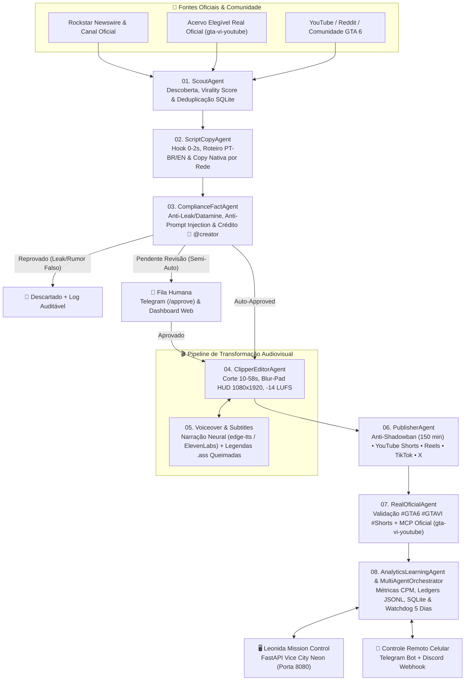

# 🌴 GTA 6 Fast Clips & Real Oficial (`gta-vi-youtube`) — Sistema Multi-Agente Autônomo 24/7

Sistema multi-agente em Python projetado para operar **100% no piloto automático em um 2º PC por 5 dias seguidos** (1 dia configurando/validando + 4 dias fora gerenciado pelo celular), unindo dois motores em um único pipeline:

1. **Página Faceless Global/BR de GTA 6**: curadoria rápida de notícias oficiais da Rockstar Games, segredos dos trailers, dicas, nostalgia de GTA V e clipes transformados com valor agregado em **YouTube Shorts, Instagram Reels, TikTok e X (6 slots/dia)**.
2. **Campeonato Real Oficial (`gta-vi-youtube`)**: produção, validação de regras, upload de Shorts `9:16` (`1080x1920`) sem marca d'água de terceiros e integração oficial via **Streamable HTTP MCP (`https://api.realoficial.com.br/mcp`)** para maximizar views validadas e ganhos por CPM.

---

## 🧠 Arquitetura Completa — Enxame de 8 Agentes + Real Oficial



### Os 8 Agentes e Papéis no Fluxo Faceless GTA 6

| # | Agente / Módulo | Responsabilidade Principal |
|---|---|---|
| **01** | `ScoutAgent` (`agents/scout.py`) | Monitora Rockstar Newswire, trailers oficiais, acervo da campanha Real Oficial e tendências da comunidade; filtra fontes já usadas em `seen_sources`. |
| **02** | `ScriptCopyAgent` (`agents/copywriter.py`) | Cria o **Hook visual (0–2s)**, roteiro de voz conciso e legendas nativas: **zero hashtags no X** + `🎥 @creator`, **até 5 hashtags no Reels**, e `#GTA6 #GTAVI #Shorts` na campanha do YouTube. |
| **03** | `ComplianceFactAgent` (`agents/compliance.py`) | Bloqueia **leaks, datamines, pirataria, exploits, marcas d'água de terceiros**, afirmações falsas (*"this confirms"* / *"isso confirma"*) sem fonte oficial e neutraliza **prompt injection** em transcrições/títulos externos. |
| **04** | `ClipperEditorAgent` (`agents/clipper.py`) | Renderiza vídeos verticais `1080x1920` (`30fps`, `H.264 + AAC`) via FFmpeg no modo `blur_pad_hud` (preservando o HUD 16:9 com fundo desfocado neon), banner de hook e normalização `-14 LUFS`. |
| **05** | `Voiceover & Subtitles` (`video/voiceover.py`, `video/subtitles.py`) | Gera narração neural PT-BR (`pt-BR-AntonioNeural` 100% gratuita via `edge-tts` ou ElevenLabs) e queima legendas dinâmicas `.ass` de alta retenção. |
| **06** | `PublisherAgent` (`agents/publisher.py`) | Publica/agenda respeitando janela mínima anti-shadowban (`150 min` na mesma rede) via YouTube Data API v3, X API v2, Buffer/Webhook ou APIs diretas Meta/TikTok. |
| **07** | `RealOficialAgent` (`agents/real_oficial.py`) | Sincroniza a campanha `gta-vi-youtube` via cliente oficial MCP (`integrations/real_oficial_client.py`), registra entradas `ChampionshipEntry` e blinda seus créditos diários. |
| **08** | `AnalyticsLearningAgent` + `MultiAgentOrchestrator` | Calcula distribuição dos pilares editoriais, views validadas, estimativa de CPM em R$, envia resumos no Telegram/Discord e mantém o loop 24/7 vivo nos 5 dias. |

### Workflow Faceless GTA 6 (Pilares & Cadência Diária)

Configurado em `config/settings.yaml` (`America/Sao_Paulo`):
- **YouTube Shorts (Campanha Real Oficial + Orgânico)**: 3 a 4 Shorts/dia (`10:00`, `14:00`, `18:00`, `21:30` BRT).
- **X / Twitter (6 Slots Diários)**:
  - `08:30` `official_news` • `10:30` `tips_tutorials` • `13:00` `gameplay_clips` • `15:30` `gta5_nostalgia` • `18:30` `spotlights` • `21:30` `countdown_recap`
- **Instagram Reels & TikTok**: 2 a 3 cortes verticais transformados por dia sem marca d'água cruzada.
- **Identidade Transparente**: Página de fãs independente (*"Fan page, not affiliated with Rockstar Games"*), com crédito explícito `🎥 @creator` em todo conteúdo comunitário.

---

## ⚡ Quickstart — Deixando o 2º PC Rodando por 5 Dias!

Ideal para montar tudo em **1 dia**, validar os primeiros cortes no modo seguro (`DRY_RUN=true`), virar a chave para `LIVE` e viajar/ficar **4 dias fora** acompanhando tudo pelo Telegram!

### 1. Pré-requisitos no 2º PC
- **Python 3.11+**
- **[uv](https://docs.astral.sh/uv/)** (gerenciador ultrarrápido de pacotes Python)
- **FFmpeg** instalado no PATH (`winget install Gyan.FFmpeg` no Windows ou `sudo apt install ffmpeg` no Linux)

### 2. Instalação e Configuração Inicial

```bash
# 1. Entre na pasta do projeto
cd GTA6VIDEOS

# 2. Copie o arquivo de variáveis de ambiente
cp .env.example .env

# 3. Sincronize dependências (incluindo suporte YouTube OAuth e testes)
uv sync --all-extras
```

### 3. Teste Imediato no Painel Web (Modo Seguro `DRY_RUN=true`)

Antes de conectar qualquer conta real, suba o **Leonida Mission Control**:

```bash
uv run uvicorn gta6_agents.dashboard.server:app --host 0.0.0.0 --port 8080
```

Abra `http://localhost:8080` no navegador e clique em **"Rodar Ciclo Demo Agora"**:
- O sistema vai descobrir um candidato elegível, escrever roteiro + copy, validar no Compliance, renderizar um `.mp4` vertical `1080x1920` com legenda `.ass` em `output/`, simular o envio para `gta-vi-youtube` e atualizar os cards em tempo real!

### 4. Iniciar Operação Contínua 24/7 no 2º PC (5 Dias Autônomos)

#### 🪟 No Windows (PowerShell)
1. Em **Configurações -> Sistema -> Energia e Suspensão**, defina *"Suspender atividade do computador"* para **Nunca** (mantenha na tomada e cabo de rede se possível).
2. Execute o script com auto-restart (watchdog), prevenção de sleep e painel simultâneo:

```powershell
Set-ExecutionPolicy -Scope Process -ExecutionPolicy Bypass
.\scripts\start_2pc_windows.ps1
```

#### 🐧 No Linux / Ubuntu / Mini-PC
Execute o launcher resiliente que mantém o orquestrador 24/7 + dashboard ativos em background com reconexão automática:

```bash
chmod +x ./scripts/start_2pc_linux.sh
./scripts/start_2pc_linux.sh
```

> **Dica de Ouro para os 4 Dias Fora**: Quando já tiver testado 1 ciclo real com sucesso, configure no `.env`:
> ```env
> DRY_RUN=false
> AUTOPILOT_MODE=semi_auto   # ou full_auto para postar 100% sem intervenção nos pilares aprovados
> ```

---

## 🔌 Passo a Passo das Integrações Oficiais

### 1. Conectar Real Oficial (`gta-vi-youtube`)

1. Acesse a página oficial da campanha pelo seu navegador e aceite os termos humanos da campanha:
   - 🔗 **[Campanha GTA VI YouTube no Real Oficial](https://app.realoficial.com.br/c/gta-vi-youtube?ro_vid=a56ec50b-725e-4c73-a353-4e3b2e80678b)**
2. No painel da sua conta Real Oficial, copie seu token de API / MCP e preencha no `.env`:
   ```env
   REAL_OFICIAL_ENABLED=true
   REAL_OFICIAL_MCP_TOKEN=seu_token_mcp_aqui
   REAL_OFICIAL_API_KEY=sua_api_key_opcional
   REAL_OFICIAL_CAMPAIGN_SLUG=gta-vi-youtube
   REAL_OFICIAL_DAILY_CREDIT_LIMIT=150
   REAL_OFICIAL_ALLOW_SPEND_CREDITS=false
   ```
3. **Garantias de Segurança Financeira & Anti-Ban**:
   - O cliente (`RealOficialClient`) comunica-se **exclusivamente** com a API/MCP oficial (`https://api.realoficial.com.br/mcp` via JSON-RPC 2.0) — **jamais** faz scraping HTML ou burla proteções anti-bot.
   - A tool `ro_start_purchase` (compra via PIX/dinheiro) é **bloqueada em código (`FORBIDDEN_MCP_TOOLS`)**.
   - Com `REAL_OFICIAL_ALLOW_SPEND_CREDITS=false` (padrão), todo o corte `9:16` e legendagem é feito **localmente de graça via FFmpeg no seu 2º PC**, gastando **0 créditos** da plataforma!
   - Revise `config/campaign_realoficial.yaml` para manter as hashtags obrigatórias (`#GTA6`, `#GTAVI`, `#Shorts`) e URLs do acervo oficial sincronizadas com o regulamento vigente.

---

### 2. Conectar YouTube Data API v3 (Upload Automático de Shorts)

Obrigatório para publicar os Shorts públicos que pontuam na campanha `gta-vi-youtube`:

1. Acesse o [Google Cloud Console](https://console.cloud.google.com/), crie um projeto e ative a **YouTube Data API v3** em *APIs e Serviços -> Biblioteca*.
2. Em *Tela de Permissão OAuth*, adicione o e-mail do seu canal YouTube como usuário de teste (ou publique o app).
3. Em *Credenciais -> Criar Credenciais -> ID do cliente OAuth*, escolha **App para computador (Desktop App)**.
4. Coloque `YOUTUBE_CLIENT_ID` e `YOUTUBE_CLIENT_SECRET` no `.env` e rode o gerador de 1 comando (em um PC com navegador):
   ```bash
   uv run --extra youtube python scripts/generate_youtube_token.py
   ```
5. Autorize o canal na janela do Google e cole o `YOUTUBE_REFRESH_TOKEN` gerado no seu `.env`:
   ```env
   YOUTUBE_ENABLED=true
   YOUTUBE_CLIENT_ID=seu_client_id
   YOUTUBE_CLIENT_SECRET=seu_client_secret
   YOUTUBE_REFRESH_TOKEN=1//04xxxxxxxxxxxx
   YOUTUBE_CHANNEL_HANDLE=@SeuCanalGTA6
   ```

---

### 3. Conectar Bot de Controle Remoto no Telegram (Gerencie pelo Celular!)

Enquanto o 2º PC trabalha sozinho nos 4 dias em que você estiver fora, o bot envia alertas a cada Short postado, avisa sobre erros e aceita comandos instantâneos:

1. No Telegram, chame o **[@BotFather](https://t.me/BotFather)**, envie `/newbot` e copie o token gerado.
2. Envie uma mensagem para o seu novo bot e descubra seu ID numérico falando com o **[@userinfobot](https://t.me/userinfobot)**.
3. Preencha no `.env`:
   ```env
   TELEGRAM_BOT_TOKEN=123456789:AAHxxxxxxxxxxxxxxxxxxx
   TELEGRAM_CHAT_ID=987654321
   DISCORD_WEBHOOK_URL=   # Opcional: webhook de um canal privado no Discord
   ```
4. **Comandos disponíveis direto do seu celular**:
   - `/status` — Resumo completo (estado ativo/pausado, Shorts enviados na `gta-vi-youtube`, views validadas, ganho estimado R$ e créditos do dia).
   - `/pause` — Pausa imediatamente novas postagens no 2º PC.
   - `/resume` — Retoma o agendamento 24/7.
   - `/approve <plan_id>` — Aprova um corte retido na fila de revisão humana.
   - `/reject <plan_id>` — Descarta um corte retido.

---

### 4. Conectar X (Twitter) API v2 & Buffer / Webhook (Reels & TikTok)

- **Para os 6 posts diários no X**:
  1. No [X Developer Portal](https://developer.x.com/), crie um App com permissão **Read and Write** e gere as 4 chaves OAuth 1.0a + Bearer Token.
  2. Configure no `.env`:
     ```env
     X_ENABLED=true
     X_API_KEY=...
     X_API_SECRET=...
     X_ACCESS_TOKEN=...
     X_ACCESS_TOKEN_SECRET=...
     X_BEARER_TOKEN=...
     ```
- **Para Instagram Reels, TikTok e Threads (via Buffer ou Webhook Make/n8n)**:
  ```env
  BUFFER_ENABLED=true
  BUFFER_ACCESS_TOKEN=seu_token_buffer
  BUFFER_PROFILE_IDS=id_perfil_reels,id_perfil_tiktok
  WEBHOOK_PUBLISHER_URL=https://hook.us1.make.com/seu_webhook_opcional
  ```
  *(Alternativamente, preencha `INSTAGRAM_ACCESS_TOKEN` + `INSTAGRAM_IG_USER_ID` e `TIKTOK_ACCESS_TOKEN` no `.env` para publicação direta via Graph API / TikTok Content Posting API).*

---

## 🗂️ Estrutura de Diretórios & Ledgers Auditáveis

```text
GTA6VIDEOS/
├── config/
│   ├── settings.yaml               # Horários BRT, limites por rede, FFmpeg 9:16 e regras de aprovação
│   └── campaign_realoficial.yaml   # Regras da campanha gta-vi-youtube, hashtags e acervo elegível
├── data/
│   └── state.db                    # SQLite (deduplicação, fila humana, publicações, créditos e flags)
├── memory/
│   ├── source_ledger.jsonl         # Histórico auditável de fontes descobertas
│   ├── asset_ledger.jsonl          # Registro de vídeos renderizados + base de permissão/crédito
│   └── posted_history.jsonl        # Ledger imutável de todos os posts publicados/simulados
├── output/                         # Vídeos finais .mp4 (1080x1920) + legendas .ass prontos
├── scripts/
│   ├── generate_youtube_token.py   # Gerador OAuth 2.0 do YOUTUBE_REFRESH_TOKEN
│   ├── start_2pc_windows.ps1       # Watchdog 5 dias para Windows PowerShell
│   └── start_2pc_linux.sh          # Watchdog 5 dias para Linux
├── src/gta6_agents/
│   ├── agents/                     # Os agentes especializados (Scout, Copy, Compliance, Clipper, etc.)
│   ├── integrations/               # Clientes oficiais Real Oficial MCP, YouTube v3, X, Meta/TikTok, Buffer
│   ├── video/                      # Downloader yt-dlp, FFmpeg Blur-Pad 9:16, Edge-TTS e legendas .ass
│   ├── orchestrator/               # Pipeline diário 24/7 + Bot Remoto Telegram/Discord
│   └── dashboard/server.py         # Painel Web FastAPI "Leonida Mission Control"
└── tests/                          # Suíte Pytest automatizada (Compliance, Copy, FFmpeg e Pipeline E2E)
```

---

## 🧪 Rodando a Suíte de Testes

Para validar o bloqueio anti-leak/anti-injection, templates de copy, renderização real FFmpeg `1080x1920` com `.ass` e o ciclo ponta a ponta:

```bash
uv run pytest -v
```
